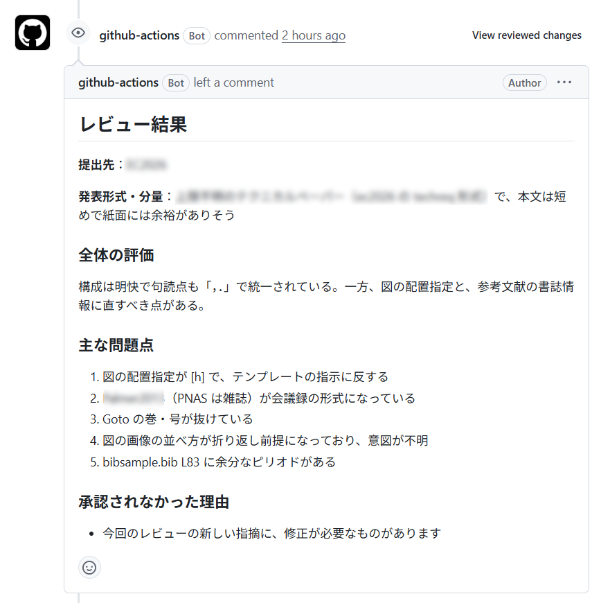
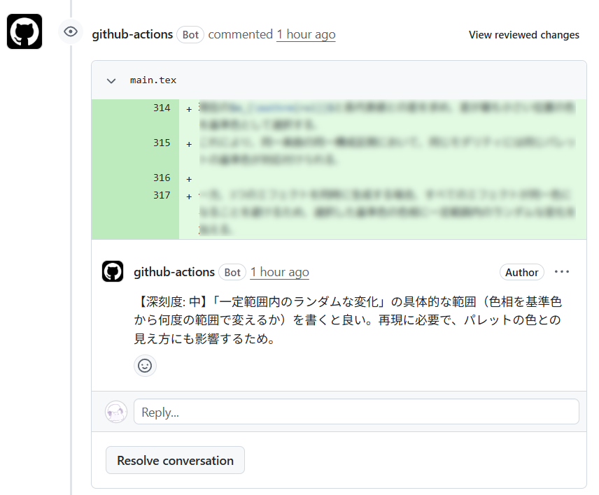
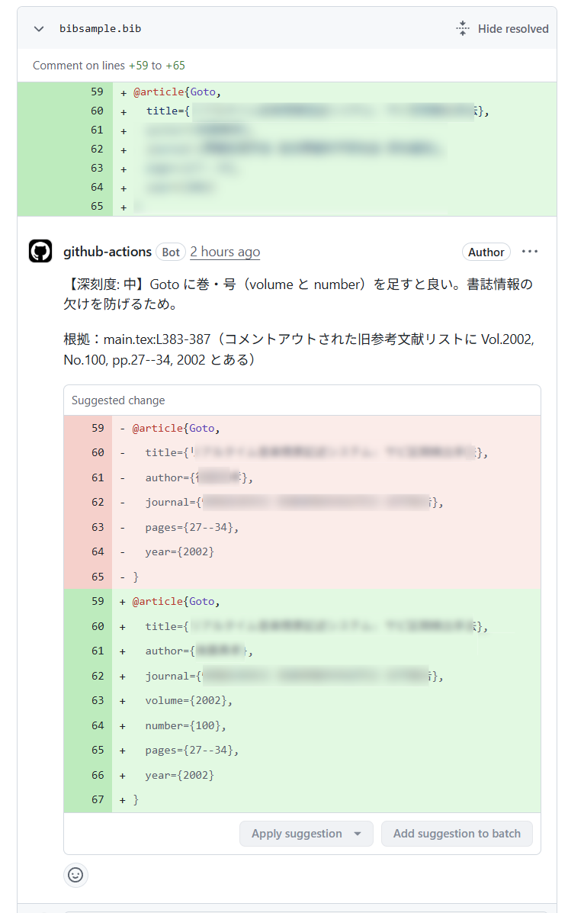
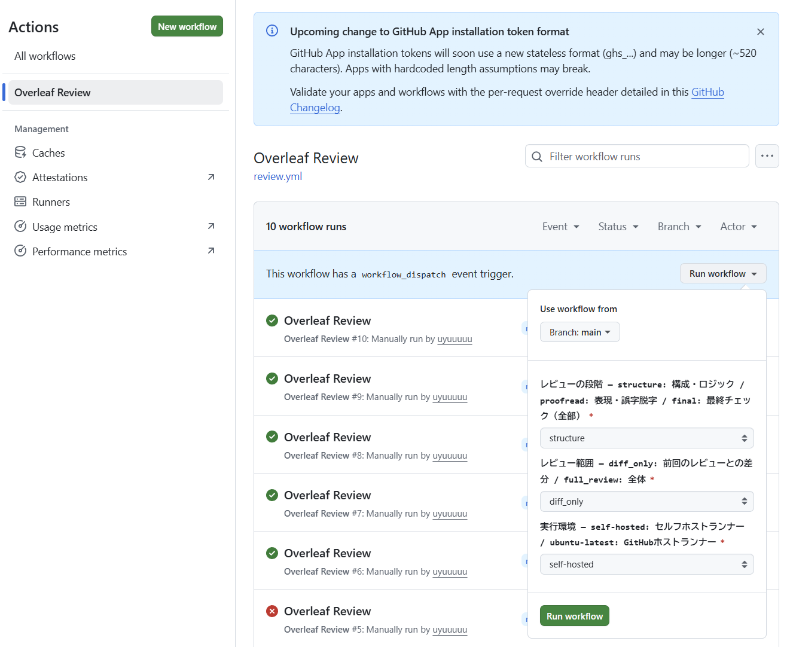
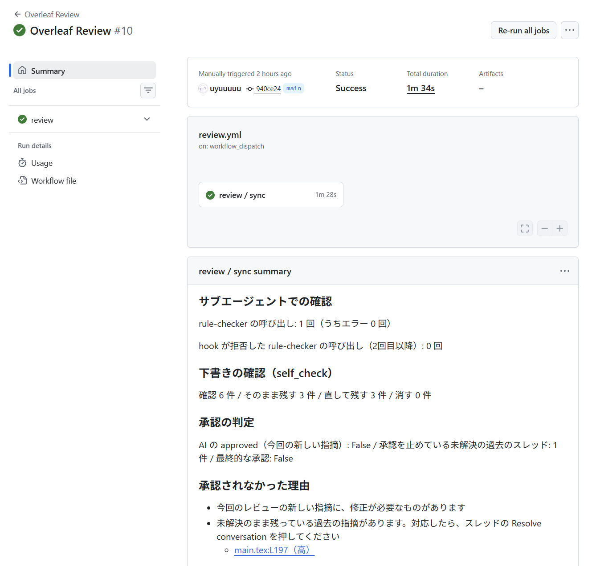
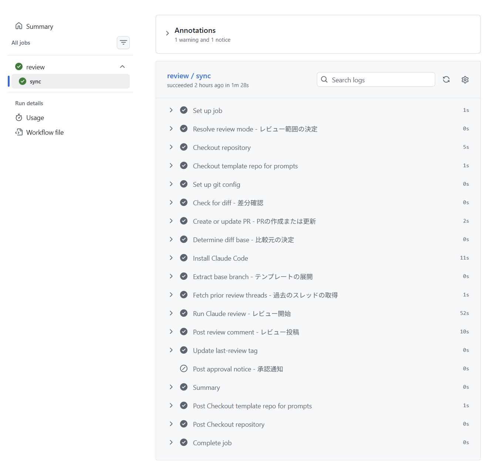

# OverleafReviewer
Overleafで書いている論文を、GitHub Actions上のClaude Codeでレビューするシステムです。  
Overleafの論文をGitHub連携でリポジトリに同期し、Actions画面から実行すると、レビュー結果がPRのコメントとして投稿されます。

このリポジトリは、研究室で運用している非公開リポジトリの中身をコピーして公開したものです。実際に動いているのは非公開リポジトリのほうなので、ワークフロー内の参照先もそちらになっています。

- レビューの段階は「構成・論理」「表現・誤字脱字」「最終チェック」の3つ
- 提出先の学会・論文誌を特定し、テンプレートの書式に沿っているかも確認
- 誤字や表記揺れには修正案が付き、PR上でコミットしてOverleafに取り込める

## スクリーンショット




## 使用技術
- レビュー：Claude Code（`claude -p`、読み取り専用ツールのみ許可）
- 実行環境：GitHub Actions（再利用可能ワークフロー）
- ランナー：セルフホスト / GitHubホスト（ubuntu-latest）
- 論文の同期：Overleaf GitHub連携

## 使い方
### 初回準備
論文リポジトリを新しく使い始めるときに1回だけ行います。
1. OverleafのGitHub連携で、論文リポジトリを `tdufi-idl` に作成
2. `examples/workflow.yml` を論文リポジトリの `.github/workflows/review.yml` としてコピー
3. 論文リポジトリの **Settings > Actions > General > Workflow permissions** で「Read and write permissions」を選び、「Allow GitHub Actions to create and approve pull requests」にチェック
4. `base` ブランチを作成  
   テンプレートを書式の基準にするので、Overleafからテンプレートを取り込んだ直後（本文を書き始める前）のコミットから作ります。
   ```sh
   git push origin <そのコミット>:refs/heads/base
   ```
5. organization secretの `REVIEWER_READ_TOKEN` がこの論文リポジトリから使えるか確認（organizationのownerが設定）
6. GitHubホストランナーで動かす場合は、下の手順で `CLAUDE_CODE_OAUTH_TOKEN` を登録

### レビューの実行
論文リポジトリのActions画面から「Overleaf Review」を実行します。



| 項目 | 選択肢 |
|------|--------|
| `review_stage` | `structure`：構成・論理 / `proofread`：表現・誤字脱字 / `final`：最終チェック（全部） |
| `review_mode` | `diff_only`：前回のレビューからの差分 / `full_review`：全体（`final` のときは常に全体） |
| `runner` | `self-hosted`（デフォルト）：セルフホストランナー / `ubuntu-latest`：GitHubホストランナー |

`main` → `base` のPRが作られ、そこにレビューが投稿されます。  
`final` で問題がなければ、承認の通知が届きます。  
過去の指摘に対応したら、そのスレッドの「Resolve conversation」を押してください。未解決のまま残っている深刻度の高・中の指摘があると承認されません。

### GitHubホストランナー（ubuntu-latest）で動かす場合
1. 手元のPCでClaude Codeにログインした状態で、トークンを発行
   ```sh
   claude setup-token
   ```
2. 論文リポジトリの **Settings > Secrets and variables > Actions** の **New repository secret** から登録
   - Name：`CLAUDE_CODE_OAUTH_TOKEN`
   - Secret：1で表示されたトークン

`self-hosted` の場合は不要です。未設定ならランナーにログイン済みのClaude Codeがそのまま使われます。

### 修正案の取り込み方
1. PRの行コメントで「Commit suggestion」を押す  
   まとめて反映するときは、それぞれ「Add suggestion to batch」を押してからまとめてコミット
2. OverleafのメニューからGitHubを開き、「Pull GitHub changes into Overleaf」で取り込む  
   「Recent commits in GitHub」に表示されないときは右上の更新ボタンを押してください。

取り込むときはOverleafでの編集を止めておいてください。GitHub側とOverleaf側で同時に変更があると競合します。

## 仕組み
- `last-review` タグ（なければ `base`）を比較元にして、Claude Codeが論文リポジトリの `.tex` と `.bib` を直接読みます。
- 使えるツールはファイルの読み取りと読み取り専用のコマンドだけなので、論文に悪意のある指示が書かれていても、影響はレビュー結果の内容までにとどまります。
- 過去のレビューのスレッドも渡し、解決済みの指摘や未解決のまま残っている指摘を重ねて出さないようにしています。直っていそうなスレッドや、対応しないと返信があるスレッドには、Resolve conversation を押すよう返信します。
- 投稿前に、確認役のサブエージェント（rule-checker）が下書きの指摘を1件ずつ確認し、残す / 直して残す / 消すを判定します。呼び出しはhookで1回に制限しています。
- 指摘には【深刻度: 高/中/低】が付きます。結果はJSON形式で受け取り、全体の評価はPRのレビュー、個別の指摘は該当行への行コメントとして投稿します。差分に含まれない行への指摘は会話タブにまとめます。
- 最終的な承認はworkflowが判定します。今回の新しい指摘で問題がなく、未解決の過去の指摘に深刻度の高・中のものがなければ承認です。
- レビュー後、`last-review` タグをHEADに移します。
- 運用者向けのメモ、rule-checkerでの確認結果、承認の判定はActionsのSummaryに出します。




### 指示文（prompts/）
| ファイル | 内容 |
|----------|------|
| `common.txt` | 全段階共通の進め方、書式の扱い、指摘の書き方 |
| `structure.txt` | 構成・論理（`\ref` と `\label` の対応を含む） |
| `proofread.txt` | 表現・表記、書式、修正案とその根拠 |
| `references.txt` | `\cite` と `.bib` の対応、書誌情報の欠けや揺れ |
| `final.txt` | 総合判断と承認の基準 |
| `checker.txt` | 確認役（rule-checker）への指示 |
| `prior_threads.txt` | 過去のスレッドの扱い方 |
| `diff_only.txt` / `full_review.txt` | レビュー範囲の読み方 |
